<picture><source media="(prefers-color-scheme: dark)" srcset="assets/hero-dark.svg"></picture>

<picture><source media="(prefers-color-scheme: dark)" srcset="assets/about-dark.svg"></picture>

<picture><source media="(prefers-color-scheme: dark)" srcset="assets/stack-dark.svg"></picture>

<a href="https://github.com/chesta132/chardy"><picture><source media="(prefers-color-scheme: dark)" srcset="assets/project-chardy-dark.svg"></picture></a>&nbsp;<a href="https://github.com/chesta132/nectic"><picture><source media="(prefers-color-scheme: dark)" srcset="assets/project-nectic-dark.svg"></picture></a>

<a href="https://github.com/chesta132/goreply"><picture><source media="(prefers-color-scheme: dark)" srcset="assets/project-goreply-dark.svg"></picture></a>&nbsp;<a href="https://github.com/chesta132/esp32-ac-midea"><picture><source media="(prefers-color-scheme: dark)" srcset="assets/project-esp32-ac-midea-dark.svg"></picture></a>

<picture><source media="(prefers-color-scheme: dark)" srcset="assets/stats-dark.svg"></picture>

<picture><source media="(prefers-color-scheme: dark)" srcset="assets/streak-dark.svg"></picture>

<picture><source media="(prefers-color-scheme: dark)" srcset="assets/wave-dark.svg"></picture>

<a href="https://chardy.dev"><picture><source media="(prefers-color-scheme: dark)" srcset="assets/button-1-dark.svg"></picture></a>&nbsp;&nbsp;<a href="https://github.com/chesta132?tab=repositories"><picture><source media="(prefers-color-scheme: dark)" srcset="assets/button-2-dark.svg"></picture></a>

<a href="https://metawka.github.io/expressive-profile/?from=chesta132"><picture><source media="(prefers-color-scheme: dark)" srcset="assets/credit-dark.svg"></picture></a>

